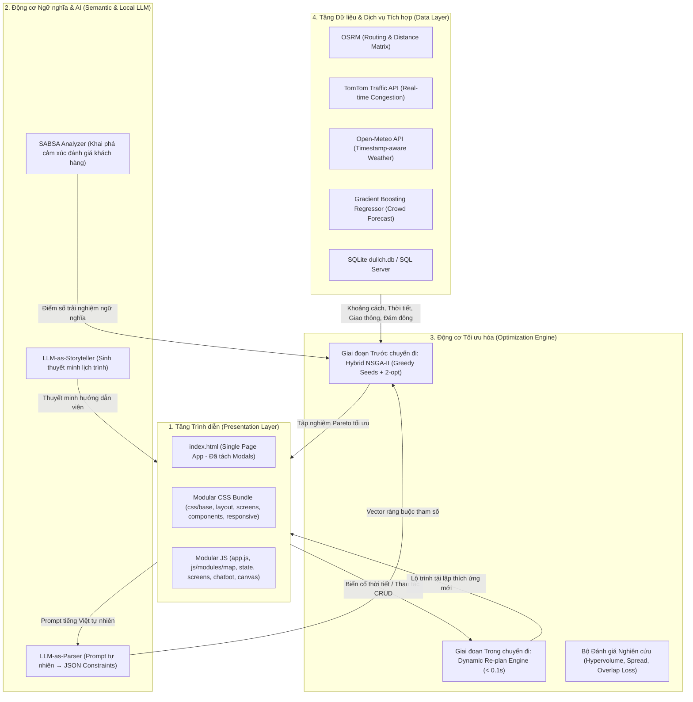

# Hệ Thống Hỗ Trợ Ra Quyết Định Lập Lịch Trình Du Lịch Thông Minh
### Smart Travel Itinerary Decision Support System (TTDP)

[](https://www.python.org/)
[](https://fastapi.tiangolo.com/)
[](https://leafletjs.com/)
[](https://ollama.com/)
[]()
[]()

> **Đề tài Nghiên cứu Khoa học**: Giải pháp ứng dụng Mô hình Ngôn ngữ Lớn Cục bộ (Edge/Local LLM) và Giải thuật Di truyền Đa Mục tiêu Lai (Hybrid NSGA-II) nhằm giải quyết bài toán Thiết kế Lịch trình Du lịch (Tourist Trip Design Problem - TTDP) theo cơ chế kép: **Lập lịch tối ưu trước chuyến đi (Pre-tour)** và **Tái lập lịch thích ứng thời gian thực trong chuyến đi (In-tour Dynamic Re-planning)**.

---

## 1. TỔNG QUAN BÀI TOÁN & ĐÓNG GÓP HỌC THUẬT

### 1.1. Bối cảnh & Tính cấp thiết (Motivation)
Trong thời đại chuyển đổi số du lịch đô thị thông minh (Smart Urban Tourism), du khách thường xuyên đối mặt với nghịch lý quá tải thông tin (Information Overload): hàng trăm ngàn đánh giá trực tuyến, biến động thất thường của thời tiết nhiệt đới và tình trạng ùn tắc giao thông cục bộ tại các đô thị lịch sử như Hà Nội. 

Các ứng dụng thương mại hiện hành (Google Maps, TripAdvisor, Klook) hiện chỉ dừng lại ở hai thái cực:
1. **Tìm đường điểm - điểm đơn lẻ**: Thiếu năng lực tổ chức chuỗi hành trình liên hoàn tối ưu hóa đồng thời nhiều mục tiêu mâu thuẫn.
2. **Gợi ý tour cứng nhắc định sẵn (Static Tours)**: Hoàn toàn mất khả năng thích ứng linh hoạt khi xảy ra các biến cố ngoại cảnh thực tế (mưa lớn đột ngột, quá tải đám đông, hoặc trễ giờ mở cửa).

Đề tài giải quyết khoảng trống nghiên cứu này bằng cách xây dựng một **Hệ Thống Hỗ Trợ Ra Quyết Định Toàn Diện (Comprehensive Decision Support System - DSS)** kết hợp giữa **Trí tuệ nhân tạo tạo sinh ngữ nghĩa (Semantic Generative AI)** và **Tối ưu hóa tiến hóa toán học (Mathematical Evolutionary Optimization)**.

---

### 1.2. Mô hình Toán học: Bài toán TTDP Mở rộng (Problem Formulation)
Hệ thống giải quyết bài toán **Tourist Trip Design Problem with Time Windows, Category Quotas, and Real-time Dynamics (TTDP-TWCQ-RD)**.

Cho tập hợp $N$ địa điểm du lịch ứng viên $\mathcal{P} = \{p_1, p_2, \dots, p_N\}$, mỗi điểm $p_i$ được đặc trưng bởi tọa độ $(\text{lat}_i, \text{lon}_i)$, khung giờ mở cửa $[O_i, C_i]$, thời gian tham quan khuyến nghị $t_i^{\text{visit}}$, danh mục thể loại $\text{cat}_i$, xếp hạng $R_i \in [1, 5]$, và tập các khía cạnh cảm xúc khai phá từ đánh giá người dùng.

Hệ thống tiến hành tối ưu hóa đồng thời **3 hàm mục tiêu Pareto ($f_1, f_2, f_3$)**:

#### Mục tiêu 1: Tối đa hóa Trải nghiệm Du khách ($f_1 \to \max$)
$$
f_1 = \sum_{i \in \text{Route}} \left[ w_{\text{pref}} \cdot \text{SABSA}(p_i, \text{user-pref}) + (1 - w_{\text{pref}}) \cdot \text{NormalizedRating}(p_i) \right]
$$
* **$\text{SABSA}(p_i, \text{user-pref}) \in [0, 1]$**: Điểm số phân tích cảm xúc khía cạnh sâu (Aspect-Based Sentiment Analysis) được bóc tách từ hàng trăm đánh giá thực tế bằng LLM, đo lường mức độ tương thích giữa không gian, dịch vụ của điểm đến với gu du lịch của người dùng (`user_pref`).
* **$\text{NormalizedRating}(p_i)$**: Điểm đánh giá trung bình chuẩn hóa về thang $[0, 1]$.
* **$w_{\text{pref}}$**: Trọng số điều chỉnh mức độ ưu tiên cá nhân hóa.

#### Mục tiêu 2: Tối thiểu hóa Tổng Thời gian Hành trình ($f_2 \to \min$)
$$
f_2 = \sum_{(i,j) \in \text{Legs}} T_{\text{travel}}(i, j, \text{vehicle}, \text{traffic}) + \sum_{i \in \text{Route}} t_i^{\text{visit}} + \sum_{i \in \text{Route}} T_{\text{wait}}(i)
$$
* **$T_{\text{travel}}$**: Thời gian di chuyển thực tế theo mạng lưới đường bộ OSRM, có nhân hệ số tắc đường theo thời gian thực từ TomTom Traffic Index.
* **$T_{\text{wait}}(i) = \max(0, O_i - \tau_i^{\text{arrive}})$**: Thời gian phải chờ đợi nếu du khách đến sớm trước khi địa điểm mở cửa.

#### Mục tiêu 3: Tối thiểu hóa Rủi ro Ngoại cảnh ($f_3 \to \min$)
$$
f_3 = \sum_{i \in \text{Route}} \left[ \text{Penalty}_{\text{crowd}}(p_i, \tau_i) + \text{Penalty}_{\text{weather}}(p_i, \tau_i) \right]
$$
* **$\text{Penalty}_{\text{crowd}} \in [0, 1]$**: Điểm số dự báo mật độ đông đúc theo thời gian $\tau_i$ từ mô hình hồi quy Gradient Boosting.
* **$\text{Penalty}_{\text{weather}} \in [0, 1]$**: Hình phạt thời tiết bất lợi (mưa rào, nắng gắt vượt ngưỡng) truy vấn theo thời gian thực từ Open-Meteo API tại thời điểm $\tau_i$.

#### Hệ thống Ràng buộc Chặt chẽ (Hard & Soft Constraints):
1. **Ràng buộc Khung thời gian (Time Windows)**: $\tau_i^{\text{arrive}} + T_{\text{wait}}(i) \le C_i - t_i^{\text{visit}}$.
2. **Ràng buộc Ngân sách Thời gian Tổng**: $T_{\text{total}} \le T_{\text{budget}}$ (theo giờ khởi hành và kết thúc mong muốn).
3. **Ràng buộc Cân bằng Danh mục (Category Quota)**: Giới hạn số lượng điểm cùng thể loại liên tiếp hoặc trong một ngày (ngăn chặn tình trạng lịch trình toàn quán cà phê hoặc toàn bảo tàng gây nhàm chán).
4. **Ràng buộc Phân cấp Phương tiện (Vehicle Accessibility)**: Kiểm soát xe ô tô / xe du lịch lớn không đi vào các tuyến ngõ nhỏ phố cổ hoặc phố đi bộ cấm xe.

---

### 1.3. Bốn Đóng góp Khoa học & Công nghệ Cốt lõi (Key Contributions)

#### 1. Đóng góp 1: Khung Tối ưu hóa Lai Hai Giai đoạn (Dual-Mode Hybrid Optimization)
* **Trước chuyến đi (Pre-tour Hybrid NSGA-II)**:
  - Cải tiến thuật toán NSGA-II tiêu chuẩn bằng chiến lược **Khởi tạo mầm hạt giống tham lam đa dạng (Greedy Constructive Seeds)** kết hợp **Toán tử tìm kiếm cục bộ 2-opt trên cá thể con (Child 2-opt Local Search)**.
  - Khắc phục triệt để nhược điểm hội tụ chậm và rơi vào cực trị địa phương của thuật toán tiến hóa truyền thống. Thực nghiệm cho thấy Hybrid NSGA-II mở rộng không gian tìm kiếm vượt trội, đạt chỉ số **Hypervolume (HV)** cao hơn và độ phân bố biên Pareto (**Spread $\Delta$**) đồng đều hơn rõ rệt.
* **Trong chuyến đi (In-tour Real-time Re-planning)**:
  - Đề xuất cơ chế thích ứng động siêu tốc với thời gian tính toán phản hồi **$< 0.1\text{s}$ ($< 100\text{ms}$)**.
  - Khi phát hiện sự cố ngoại cảnh (mưa rào bất chợt hoặc trễ giờ), động cơ tự động loại bỏ các điểm ngoài trời gặp rủi ro, truy vấn kho dự phòng để thay thế bằng không gian trong nhà tương đương mà vẫn giữ vững tính liên tục của lịch trình, tối thiểu hóa **Hao tổn xáo trộn lộ trình (Overlap Loss - OL)**.

#### 2. Đóng góp 2: Tích hợp Mô hình Ngôn ngữ Lớn Cục bộ (Edge/Local LLM Integration)
* **LLM-as-Parser**: Ứng dụng mô hình LLaMA 3.2 chạy cục bộ (Ollama) đóng vai trò bộ phân tích ngữ nghĩa tự nhiên. Du khách có thể nhập yêu cầu tự do bằng tiếng Việt (ví dụ: *"Tôi muốn đi dạo 6 tiếng, thích cà phê cổ điển và chụp ảnh, không thích chỗ đông đúc, đi xe máy"*), hệ thống tự động bóc tách thành vector ràng buộc JSON toán học chuẩn hóa.
* **LLM-as-Storyteller**: Tự động chuyển đổi chuỗi tọa độ khô khan thành bài thuyết minh hành trình giàu cảm xúc, kết nối các giá trị lịch sử và văn hóa bản địa theo văn phong hướng dẫn viên du lịch chuyên nghiệp.
* **Phân tích Cảm xúc Khía cạnh (SABSA)**: Khai phá các khía cạnh dịch vụ chuyên biệt (vệ sinh, giá trị tiền bạc, không gian, đồ uống) từ kho đánh giá khách hàng để tạo nên chỉ số trải nghiệm khách quan.

#### 3. Đóng góp 3: Hợp nhất Dữ liệu Ngoại cảnh Đa nguồn Động (Context-Aware Multi-Source Fusion)
* Hợp nhất dữ liệu không đồng nhất từ 4 nguồn độc lập:
  1. **OSRM Engine**: Tính toán ma trận cự ly và thời gian di chuyển theo đường bộ thực tế.
  2. **TomTom Traffic API**: Hệ số tắc nghẽn giao thông cập nhật theo thời gian thực.
  3. **Open-Meteo API**: Dữ liệu khí tượng chi tiết (nhiệt độ, lượng mưa, xác suất mưa) theo tọa độ và giờ ghé thăm.
  4. **Gradient Boosting Regressor**: Dự báo xu hướng đám đông theo chu kỳ tuần và giờ trong ngày.
* **Hệ thống Kiểm định Dữ liệu (Audit & Data Quality)**: Thiết kế cơ chế giám sát và tự động ghi log mọi lần kích hoạt dữ liệu giả lập (synthetic fallback), đảm bảo tính minh bạch và độ tin cậy khoa học tuyệt đối cho các bài báo nghiên cứu.

#### 4. Đóng góp 4: Nền tảng Ra Quyết định Trực quan & Có thể Giải thích (Interactive & Explainable DSS)
* **Giao diện Trợ lý Trực quan**: Hỗ trợ du khách đối chiếu trực quan sự đánh đổi giữa 3 mục tiêu trên bảng so sánh Pareto, xem trước lộ trình đa tầng trên bản đồ Leaflet (Esri Street / OSM Hot), và kéo-thả điều chỉnh trực tiếp các mốc thời gian.
* **AI Giải thích Quyết định (Explainable AI - XAI)**: Mỗi khi hệ thống đề xuất đổi điểm hoặc đổi lịch, Chatbot AI luôn đưa ra lời giải thích minh bạch dựa trên dữ liệu ngữ cảnh (ví dụ: *"Đề xuất hoãn điểm ngoài trời X do phát hiện khả năng mưa 80% lúc 15:00 và thay thế bằng bảo tàng Y gần đó"*).

---

## 2. KIẾN TRÚC HỆ THỐNG (SYSTEM ARCHITECTURE)



---

## 3. CẤU TRÚC THƯ MỤC CHUẨN MỰC (CLEAN ARCHITECTURE)

Kho mã nguồn được cấu trúc chặt chẽ thành 7 khoang chức năng độc lập:

```text
lo_trinh_du_lich/
├── backend/                        # [BACKEND ENGINE] Toàn bộ mã nguồn API & Lõi giải thuật
│   ├── main.py                     # Entry point chính của FastAPI server
│   ├── config.py                   # Cấu hình tham số & tự động nhận diện CSDL
│   ├── ai_advisor.py               # Router Trợ lý du lịch AI Advisor
│   ├── hybrid_nsga.py              # Giải thuật lai Hybrid NSGA-II
│   ├── OnlyNSGA.py                 # Thuật toán đối chứng NSGA-II baseline
│   ├── replan_engine.py            # Giải thuật tái lập lịch động trong chuyến đi (< 0.1s)
│   ├── crowd_prediction.py         # Dự báo mật độ đám đông Gradient Boosting
│   ├── api/                        # Tầng HTTP API (Routers, Schemas, Scheduling, Factors)
│   ├── core/                       # Lõi tối ưu (nsga2, objectives, timeline, audit)
│   ├── services/                   # Dịch vụ ngoài (ollama, parser, absa, tomtom, weather, osrm)
│   └── data_v2/                    # Bộ công cụ xử lý dữ liệu địa điểm
│
├── frontend/                       # [FRONTEND SPA] Giao diện người dùng dạng Module hóa
│   ├── index.html                  # Khung sườn chính (Đã rút gọn còn ~680 dòng)
│   ├── app.js                      # Entry point điều phối JavaScript (~24 dòng)
│   ├── style.css                   # Master CSS Bundle nạp các module qua @import (~13 dòng)
│   ├── css/                        # 7 module CSS (base, layout, screen1, screen2, screen3, components, responsive)
│   ├── components/                 # Các component HTML độc lập
│   │   └── modals/                 # 7 modal popup (place_detail, add, replace, change_time, profile, favorites, preview)
│   ├── js/                         # 8 module JavaScript chuyên trách
│   │   ├── data/reviews.js         # Từ điển 31 đánh giá tiếng Việt chuẩn hóa
│   │   ├── modals_bundle.js        # Script nạp component tự động
│   │   └── modules/                # map.js, state.js, screen1.js, screen2.js, screen3.js, canvas_export.js, chatbot.js, modals.js
│   └── images/                     # Kho ảnh địa điểm du lịch nội bộ
│
├── data/                           # [DATA STORE] Cơ sở dữ liệu và tài nguyên tĩnh
│   ├── dulich.db                   # CSDL SQLite chuẩn hóa tích hợp sẵn
│   ├── DuLichThongMinh.sql         # Script cấu trúc CSDL SQL Server
│   ├── crowd_history.csv           # Dữ liệu lịch sử quan sát đám đông
│   └── reviews_data.json           # Dữ liệu đánh giá dạng JSON
│
├── experiments/                    # [RESEARCH & PAPER] Thực nghiệm khoa học viết bài báo
│   ├── run_experiments.py          # Script chạy 30 kịch bản thực nghiệm (Tạo Table 1 & Table 2)
│   ├── evaluation.py               # Đo lường Hypervolume, Spread, Overlap Loss
│   ├── crawl_serpapi_maps.py       # Công cụ thu thập dữ liệu thực tế
│   └── pareto_analysis.xlsx        # Bảng số liệu phân tích đường biên Pareto
│
├── tests/                          # [TEST SUITE] Kiểm thử tự động toàn diện
│   ├── conftest.py                 # Thiết lập sys.path tự động cho runner
│   ├── test_backend_core.py        # Kiểm thử toàn diện API backend
│   ├── test_adaptive_preference.py # Kiểm thử cơ chế thích ứng gu du lịch
│   ├── test_research_modules.py    # Kiểm thử các module nghiên cứu
│   └── ...                         # 12 bài test đơn vị và tích hợp
│
├── scripts/                        # [UTILITIES] Công cụ vận hành tự động
│   └── setup_ai.bat                # Tự động kiểm tra & khởi động Ollama LLaMA 3.2
│
├── docs/                           # [DOCUMENTATION] Tài liệu hướng dẫn & Quy chế
│   ├── setup_guide.md              # Hướng dẫn cài đặt môi trường chi tiết
│   └── git_workflow.md             # Quy chuẩn làm việc nhóm trên GitHub
│
├── .env.example                    # Mẫu khai báo biến môi trường API
├── .gitignore                      # Bộ quy tắc chặn file rác chuẩn mực
├── pytest.ini                      # Cấu hình Pytest tự động
├── Dockerfile                      # Đóng gói Docker container
├── docker-compose.yml              # Cấu hình triển khai dịch vụ
└── requirements.txt                # Danh mục thư viện phụ thuộc Python
```

---

## 4. HƯỚNG DẪN CÀI ĐẶT & KHỞI CHẠY (QUICK START)

### Bước 1: Khởi tạo Môi trường Python
```bash
# Tạo môi trường ảo
python -m venv venv

# Kích hoạt môi trường (Windows PowerShell):
.\venv\Scripts\Activate.ps1

# Cài đặt toàn bộ thư viện:
pip install -r requirements.txt
```

### Bước 2: Thiết lập Biến Môi trường
Sao chép `.env.example` thành `.env`:
```bash
cp .env.example .env
```
*(Nếu không có API key TomTom hoặc SerpApi, hệ thống tự động kích hoạt Synthetic Fallback để ứng dụng chạy bình thường mà không báo lỗi).*

### Bước 3: Khởi chạy AI Engine (Tùy chọn)
Chạy script tự động tải model LLaMA 3.2 qua Ollama:
```bash
scripts\setup_ai.bat
# Hoặc khởi động thủ công qua terminal:
ollama run llama3.2
```

### Bước 4: Khởi chạy Máy chủ Backend
```bash
uvicorn backend.main:app --reload --port 8000
```
* **Giao diện Người dùng (SPA)**: Truy cập `http://localhost:8000/`
* **Tài liệu API Tương tác (Swagger UI)**: `http://localhost:8000/docs`

---

## 5. TÁI HIỆN THỰC NGHIỆM KHOA HỌC (REPRODUCIBILITY)

### Kiểm thử Tự động Hệ thống (Automated Testing):
```bash
pytest tests/
```

### Chạy Thực nghiệm Đối sánh Thuật toán (Paper Benchmarks):
Hệ thống cung cấp sẵn runner để chạy 30 kịch bản thử nghiệm đánh giá thuật toán theo các kích thước bài toán khác nhau:
```bash
# Chạy thử nghiệm nhanh (Smoke test 6 kịch bản):
python experiments/run_experiments.py --quick --cases 6

# Chạy toàn bộ 30 kịch bản nghiên cứu (Tạo số liệu cho bài báo):
python experiments/run_experiments.py
```

**Kết quả thực nghiệm tự động xuất bản tại:**
* `experiments/TABLE1.md` – So sánh hiệu năng chính: Greedy vs Standard NSGA-II vs Hybrid NSGA-II (Chỉ số Hypervolume, Spread, Thời gian tính toán).
* `experiments/TABLE2.md` – Nghiên cứu cắt bỏ thành phần (Ablation Study: đánh giá vai trò của mầm Greedy và toán tử 2-opt).
* `experiments/results.json` – Dữ liệu log số học thô của từng ca thử nghiệm.

---

## 6. DANH SÁCH ENDPOINTS TRỌNG TÂM

| Phương thức | Đường dẫn API | Chức năng học thuật / Nghiệp vụ |
| :--- | :--- | :--- |
| `POST` | `/api/optimize-route-hybrid` | Tối ưu hóa 3 mục tiêu bằng **Hybrid NSGA-II** (Pre-tour) |
| `POST` | `/api/optimize-route-nsga2` | Chạy thuật toán baseline **NSGA-II chuẩn** phục vụ đối chứng |
| `POST` | `/api/replan` | Tái lập lịch động thích ứng tức thì (**In-tour Re-plan < 0.1s**) |
| `POST` | `/api/parse-prompt` | **LLM-as-Parser**: Phân tích prompt tiếng Việt tự do ra ràng buộc JSON |
| `POST` | `/api/narrative` | **LLM-as-Storyteller**: Tự động sinh kịch bản thuyết minh hành trình |
| `POST` | `/api/absa` | Phân tích cảm xúc đa khía cạnh (**SABSA**) từ review địa điểm |
| `GET` | `/api/dynamic-signals` | Lấy dữ liệu ngoại cảnh động: Thời tiết (Open-Meteo) & Giao thông (TomTom) |
| `GET` | `/api/crowd-forecast` | Dự báo mật độ đám đông theo thời gian từ mô hình **Gradient Boosting** |

---

## 7. QUY CHUẨN ĐÓNG GÓP & LÀM VIỆC NHÓM

Nhằm duy trì chất lượng mã nguồn và sự trong sạch của cây Git:
* Tất cả thành viên tham gia bắt buộc đọc kỹ quy chế tại: [docs/git_workflow.md](docs/git_workflow.md).
* **Nghiêm cấm** chỉnh sửa trực tiếp mã nguồn trên giao diện Web của GitHub.
* Mọi tính năng mới hoặc sửa lỗi bắt buộc phải tạo nhánh từ `develop` theo quy ước `feat/<tên-tính-năng>` hoặc `fix/<tên-lỗi>` và phải thông qua Pull Request để được duyệt gộp mã nguồn.
