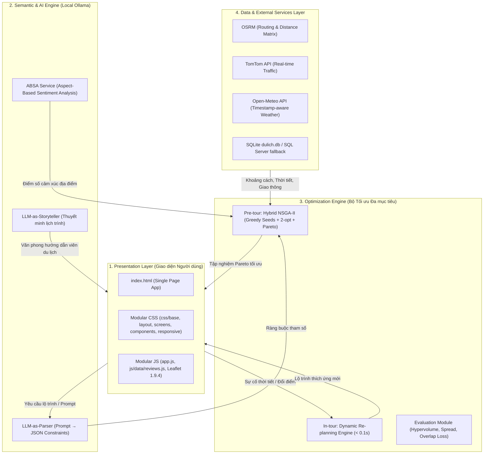

# Hệ Thống Hỗ Trợ Ra Quyết Định Lập Lịch Trình Du Lịch Thông Minh
### Smart Travel Itinerary Decision Support System (TTDP)

[](https://www.python.org/)
[](https://fastapi.tiangolo.com/)
[](https://leafletjs.com/)
[](https://ollama.com/)
[]()

> **Đề tài Nghiên cứu Khoa học**: Giải pháp ứng dụng Mô hình Ngôn ngữ Lớn (Local LLM) và Giải thuật Di truyền Đa Mục tiêu Lai (Hybrid NSGA-II) nhằm giải quyết bài toán Thiết kế Lịch trình Du lịch (Tourist Trip Design Problem - TTDP) theo cơ chế kép (Dual-Mode: Lập lịch trước chuyến đi & Tái lập lịch động trong chuyến đi).

---

## 1. TỔNG QUAN BÀI TOÁN & ĐÓNG GÓP KHOA HỌC

Bài toán **Tourist Trip Design Problem (TTDP)** mở rộng đặt ra yêu cầu lập lộ trình tham quan tối ưu cho du khách tại các đô thị với hàng loạt ràng buộc thực tế: khung giờ mở/đóng cửa, định mức thời gian, điều kiện thời tiết thực tế, mật độ đám đông và giới hạn tải giao thông theo phương tiện.

### Các hàm mục tiêu tối ưu (3 Objectives):
1. **Tối đa hóa Trải nghiệm du khách ($f_1 \to \max$):**
   $$f_1 = w_{\text{pref}} \cdot \text{SABSA} + (1 - w_{\text{pref}}) \cdot \text{Rating}$$
   Trong đó $\text{SABSA}$ là điểm số khai phóng ngữ nghĩa cảm xúc từ đánh giá thực tế (Review) của du khách thông qua mô hình phân tích Aspect-Based Sentiment Analysis.
2. **Tối thiểu hóa Tổng thời gian hành trình ($f_2 \to \min$):**
   $$f_2 = T_{\text{travel}} + T_{\text{visit}} + T_{\text{wait}}$$
3. **Tối thiểu hóa Hình phạt Rủi ro ($f_3 \to \min$):**
   $$f_3 = \text{Penalty}_{\text{crowd}} + \text{Penalty}_{\text{weather}}$$

### Điểm mới của đề tài:
* **LLM-as-Parser**: Chuyển đổi ngôn ngữ tự nhiên từ mong muốn du khách thành vector ràng buộc toán học JSON chuẩn hóa.
* **Hybrid NSGA-II Optimizer**: Khởi tạo quần thể ban đầu bằng Greedy kết hợp tìm kiếm cục bộ 2-opt, giúp tăng tốc độ hội tụ và độ phủ biên Pareto (Hypervolume vượt trội so với NSGA-II truyền thống).
* **Dual-Mode Re-planning (In-tour)**: Khi gặp sự cố đột xuất (mưa to, tắc đường, trễ giờ), thuật toán tái lập lịch thích ứng trong thời gian $< 0.1s$ kèm lời giải thích ngữ cảnh thông minh từ AI.

---

## 2. KIẾN TRÚC HỆ THỐNG (SYSTEM ARCHITECTURE)



---

## 3. CẤU TRÚC THƯ MỤC CHUẨN HÓA

```text
lo_trinh_du_lich/
├── main.py                     # Entry point chính của FastAPI server
├── config.py                   # Quản lý cấu hình & biến môi trường tập trung
├── pytest.ini                  # Cấu hình kiểm thử tự động
├── requirements.txt            # Danh sách thư viện Python
├── .env.example                # Mẫu biến môi trường
├── .gitignore                  # Chặn file log, cache, runtime data
│
├── index.html                  # Giao diện web chính
├── app.js                      # Controller trung tâm của frontend
├── style.css                   # Master CSS Bundle (nạp các component qua @import)
│
├── css/                        # [MODULAR CSS] Chia nhỏ theo BEM / Component
│   ├── base.css                # Hệ thống màu sắc, typography, reset
│   ├── layout.css              # Navbar, Sidebar, khung lưới
│   ├── screen1.css             # Màn hình 1: Nhập liệu & GPS
│   ├── screen2.css             # Màn hình 2: Lộ trình đề xuất & Bảng Pareto
│   ├── screen3.css             # Màn hình 3: Timeline & Tái lập lịch động
│   ├── components.css          # Popup địa điểm, Chatbot, Thẻ yêu thích
│   └── responsive.css          # Tối ưu giao diện điện thoại & máy tính bảng
│
├── js/                         # [MODULAR JS] Dữ liệu & Module tách biệt
│   └── data/
│       └── reviews.js          # Từ điển đánh giá tiếng Việt có dấu
│
├── api/                        # Tầng xử lý API HTTP (FastAPI Routers)
│   ├── db.py                   # Kết nối CSDL SQLite/SQL Server
│   ├── scheduling.py           # Mô phỏng thời gian & tính toán 2-opt
│   ├── generation.py           # Sinh cấu trúc lộ trình
│   └── routers/
│       ├── core.py             # Router địa điểm, danh mục, đề xuất
│       ├── itinerary.py        # Router thao tác lộ trình (CRUD điểm)
│       └── research.py         # Router phục vụ thực nghiệm & thuật toán
│
├── core/                       # Lõi giải thuật tối ưu hóa toán học
│   ├── nsga2.py                # Thuật toán NSGA-II chuẩn
│   ├── objectives.py           # 3 hàm mục tiêu & Scale dữ liệu
│   ├── timeline.py             # Mô phỏng di chuyển - chờ - tham quan
│   └── audit.py                # Ghi nhận chất lượng dữ liệu & fallback
│
├── services/                   # Các dịch vụ tích hợp bên ngoài
│   ├── ollama.py               # Client kết nối mô hình LLaMA qua Ollama
│   ├── parser.py               # LLM Semantic Parser
│   ├── absa_service.py         # Khai phá cảm xúc đánh giá địa điểm
│   ├── tomtom_service.py       # Dịch vụ giao thông thời gian thực
│   ├── weather_service.py      # Dịch vụ dự báo thời tiết Open-Meteo
│   ├── osrm.py                 # Ma trận khoảng cách OSRM
│   └── serpapi.py              # Dịch vụ lấy thông tin mở cửa & review
│
├── experiments/                # Phục vụ chạy thực nghiệm viết bài báo NCKH
│   ├── run_experiments.py      # Chạy 30 kịch bản tạo Bảng 1 & Bảng 2
│   ├── evaluation.py           # Tính toán chỉ số Hypervolume & Overlap
│   └── pareto_analysis.xlsx    # Dữ liệu phân tích đường biên Pareto
│
├── tests/                      # Toàn bộ test case kiểm thử hệ thống
│   ├── conftest.py             # Cấu hình sys.path cho runner
│   ├── test_backend_core.py
│   ├── test_adaptive_preference.py
│   ├── test_research_modules.py
│   └── ...
│
├── data/                       # Dữ liệu tĩnh & CSDL
│   ├── dulich.db               # SQLite database tích hợp sẵn
│   └── reviews_data.json       # Dữ liệu review chuẩn hóa
│
├── scripts/                    # Scripts tiện ích hệ thống
│   └── setup_ai.bat            # Tự động kiểm tra & khởi động Ollama LLaMA
│
└── docs/                       # Tài liệu hướng dẫn & Quy chế nhóm
    ├── setup_guide.md          # Hướng dẫn cài đặt chi tiết
    └── git_workflow.md         # Quy chuẩn làm việc nhóm trên GitHub
```

---

## 4. HƯỚNG DẪN CÀI ĐẶT & KHỞI CHẠY (QUICK START)

### Bước 1: Chuẩn bị môi trường Python
```bash
# Tạo môi trường ảo
python -m venv venv

# Kích hoạt môi trường (Windows PowerShell):
.\venv\Scripts\Activate.ps1

# Cài đặt thư viện:
pip install -r requirements.txt
```

### Bước 2: Cấu hình biến môi trường
Sao chép `.env.example` thành `.env`:
```bash
cp .env.example .env
```
*(Nếu không có API key TomTom hoặc SerpApi, hệ thống tự động sử dụng Synthetic Fallback mà không báo lỗi).*

### Bước 3: Khởi chạy AI Engine (Tùy chọn)
Chạy script tự động tải model LLaMA 3.2 qua Ollama:
```bash
scripts\setup_ai.bat
# Hoặc khởi động thủ công:
ollama run llama3.2
```

### Bước 4: Khởi chạy Backend Server
```bash
uvicorn backend.main:app --reload --port 8000
```
- **Giao diện ứng dụng**: Truy cập `http://localhost:8000/`
- **Tài liệu API tương tác (Swagger UI)**: `http://localhost:8000/docs`

---

## 5. TÁI HIỆN THỰC NGHIỆM KHOA HỌC (REPRODUCIBILITY)

Để chạy kiểm thử tự động toàn bộ hệ thống:
```bash
pytest tests/
```

Để chạy thực nghiệm 30 kịch bản nghiên cứu tái hiện kết quả trong bài báo khoa học:
```bash
# Chạy thử nghiệm nhanh (Smoke test):
python run_experiments.py --quick --cases 6

# Chạy đầy đủ 30 kịch bản:
python run_experiments.py
```
**Kết quả đầu ra sinh tại:**
* `experiments/TABLE1.md` – So sánh hiệu năng: Greedy vs Only NSGA-II vs Hybrid NSGA-II.
* `experiments/TABLE2.md` – Nghiên cứu cắt bỏ thành phần (Ablation Study).
* `experiments/results.json` – Số liệu thô (Hypervolume, Spread, Computing time, Overlap Loss).

---

## 6. DANH SÁCH ENDPOINTS TRỌNG TÂM

| Phương thức | Đường dẫn API | Chức năng |
| :--- | :--- | :--- |
| `POST` | `/api/optimize-route-hybrid` | Tối ưu hóa 3 mục tiêu bằng Hybrid NSGA-II (Trước chuyến đi) |
| `POST` | `/api/optimize-route-nsga2` | Chạy thuật toán baseline NSGA-II chuẩn (Đối chứng khoa học) |
| `POST` | `/api/replan` | Tái lập lịch động thích ứng khi gặp sự cố thời tiết/giao thông |
| `POST` | `/api/parse-prompt` | LLM Parser: Phân tích mong muốn ngôn ngữ tự nhiên ra JSON |
| `POST` | `/api/narrative` | LLM Storyteller: Tự động viết bài thuyết minh cho hành trình |
| `POST` | `/api/absa` | Phân tích cảm xúc đa khía cạnh (SABSA) từ đánh giá địa điểm |
| `GET` | `/api/dynamic-signals` | Lấy dữ liệu thời tiết (Open-Meteo) và giao thông (TomTom) |

---

## 7. QUY CHUẨN LÀM VIỆC NHÓM TRÊN GITHUB

Để đảm bảo dự án không bị rác nhánh và không xung đột mã nguồn:
* Mọi thành viên bắt buộc đọc tài liệu quy chế tại: [docs/git_workflow.md](docs/git_workflow.md).
* **Nghiêm cấm** sửa code trực tiếp trên trình duyệt Web GitHub.
* Mọi tính năng mới hoặc sửa lỗi đều phải tạo nhánh dạng `feat/<tính-năng>` hoặc `fix/<lỗi>` từ `develop` và tạo Pull Request để duyệt trước khi merge.
